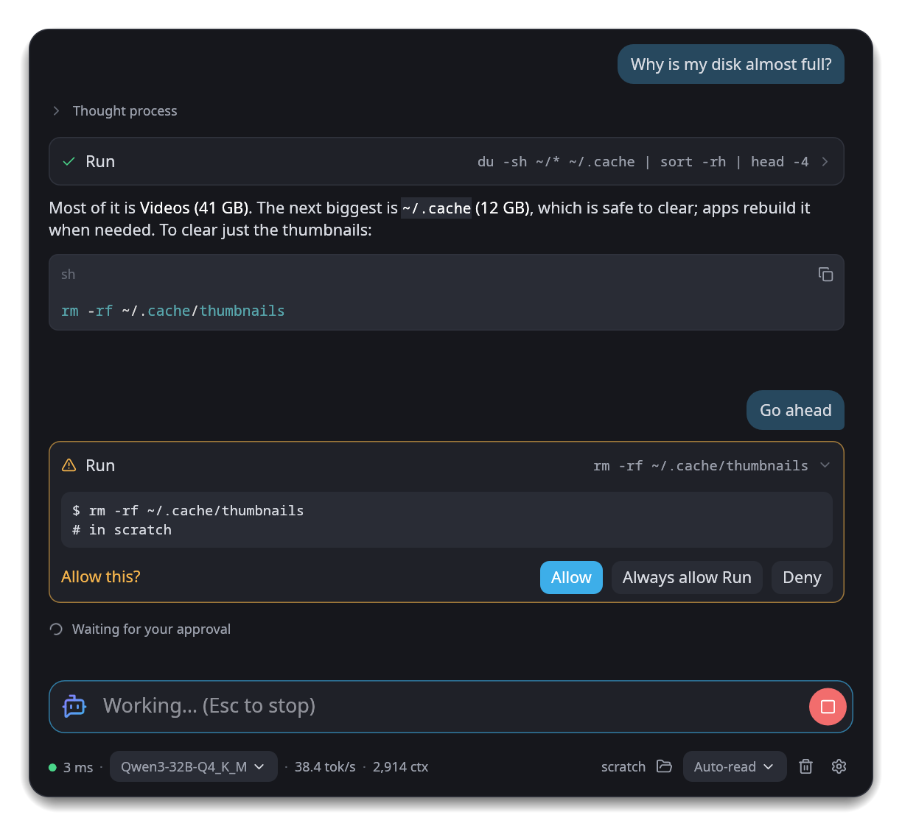
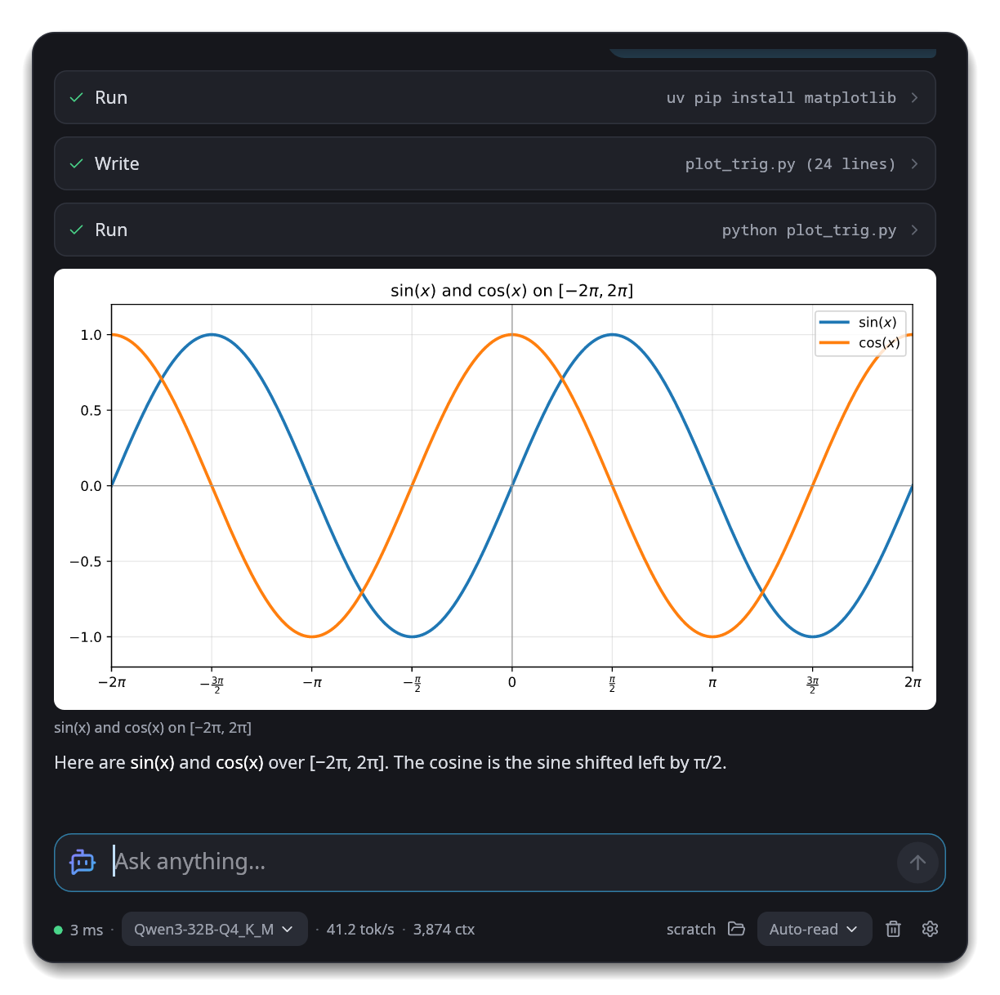

# LoKAI

LoKAI is a launcher-style chat client for KDE Plasma that talks only to AI models running on your
own hardware: this PC, or another machine on your network. Press a shortcut, ask, and the answer
streams in. It can also work on your machine: run shell commands and read, edit and search files,
asking for your approval first.

<p>
  
  
</p>

## Features

- A borderless launcher on **Meta+Alt+Space**, centered on the screen under your mouse. It starts
  as a single prompt and grows into a conversation, staying centered as its height changes.
- Local only: it refuses servers outside loopback, private IP ranges and LAN host names. It speaks
  plain http to any OpenAI-compatible server: llama.cpp (`llama-server --jinja`), Ollama,
  LM Studio, vLLM, …
- Tools: run commands, read, write and edit files, list directories, search file contents. You
  choose when it asks: before every tool, only before tools that change something, or never.
- A scratch directory (`~/.local/share/lokai/scratch` by default) where commands start and where
  temporary and generated files go.
- Pictures in the chat: ask for a plot or chart, and the model draws it with Python and shows it
  inline; click it to open it in your image viewer
- LaTeX math in answers is typeset
- Streaming answers with Markdown, syntax-highlighted code blocks with a copy button, and the
  model's reasoning folded away
- A tray icon with live status (connection and latency, model, tok/s, context size, activity) and
  *Open Chat*, *Clear Session*, *Settings…*, *Exit*. Middle-click toggles the chat.
- Follows your KDE color scheme, accent color and fonts; icons from Lucide
- The conversation is kept across restarts

## Installation

Download a package for your distribution from the
[releases page](https://github.com/YesserLab/lokai/releases):

```sh
# Debian / Ubuntu
sudo apt install ./lokai_1.2.0_amd64.deb

# Fedora
sudo dnf install ./lokai-1.2.0-1.x86_64.rpm

# Arch / Manjaro
sudo pacman -U lokai-1.2.0-1-x86_64.pkg.tar.zst
```

Each package installs the `lokai` binary, a desktop entry and the icon. They need glibc 2.39 or
newer: Ubuntu 24.04+, Debian 13+, Fedora 40+, or Arch. LoKAI needs a Plasma 6 Wayland session (X11
isn't supported); the window placement relies on KWin. Optionally, LoKAI depends on `uv` to make its
own Python venv for scripts. The packages also recommend `wl-clipboard`, so copied text stays on
the clipboard after the launcher closes, and `ripgrep` for faster searches.

LoKAI doesn't add itself to autostart. To start it with your session, add it in System Settings →
Autostart and change the command to `lokai --background`, which starts it with only the tray icon.

## Usage

Run `lokai`, or launch "LoKAI" from your application menu. On first start, open the settings
(Ctrl+, or the gear icon) and enter your server's URL. The default is `http://127.0.0.1:8080`, a
server on this PC; for another machine on your network, use its address, e.g.
`http://192.168.1.50:8080`. LoKAI picks the first model the server lists; you can switch models
from the footer.

| Key | Action |
|---|---|
| Meta+Alt+Space | toggle the launcher (change it in System Settings → Keyboard → Shortcuts → LoKAI) |
| Enter / Shift+Enter | send / new line |
| Enter (prompt empty) | allow the pending tool call |
| ↑ / ↓ | recall previous prompts |
| Esc | stop the reply, leave settings, or close |
| Ctrl+N | clear the session |
| Ctrl+, | settings |

From the command line: `lokai` (start, or show the running instance), `lokai --toggle`,
`lokai --settings`, `lokai --background`, `lokai --quit`.

The settings live in `~/.config/lokai/config.toml`:

- **Server**: URL (`/v1` is added if the URL has no path), optional API key, model, local network
  restriction
- **Generation**: temperature, max tokens, idle timeout, extra instructions for the system prompt
- **Tools**: on/off, approval mode, start directory, scratch directory, command timeout, output
  limit, max tool rounds
- **Window**: launcher size, hide on focus loss, tray icon, keep history
  (`~/.local/share/lokai/history.json`)

The tools:

| Tool | Read-only | |
|---|---|---|
| `run_command` | no | bash; stdin is /dev/null; a timeout kills the whole process group; `cd` persists between calls |
| `read_file` | yes | numbered lines, offset/limit |
| `write_file` | no | creates parent directories |
| `edit_file` | no | exact string replacement (unique unless `replace_all`) |
| `list_directory` | yes | |
| `search_files` | yes | ripgrep, falling back to grep |
| `show_image` | yes | shows a PNG, JPEG or SVG file inline in the chat |

Commands run as your user, so the approval mode is your safety net. They start in the scratch
directory, which is also their `$TMPDIR`; open it with the folder button in the footer.

## How it fits into Plasma

- **Tray**: a StatusNotifierItem. The monochrome icon is an SVG with Plasma's `ColorScheme-Text`
  class, so the panel recolors it.
- **Shortcut**: registered with KGlobalAccel over D-Bus, so it shows up in System Settings.
- **Placement**: Wayland apps can't position their own windows, so on every open LoKAI loads a
  small KWin script over D-Bus. It centers the launcher on the screen under the cursor (again
  whenever the launcher's height changes), keeps it above other windows, hides it from the
  taskbar and focuses it.
- **Single instance**: the running app owns `org.lokai.LoKAI` on the session bus; a second `lokai`
  hands its command to it.

## Building from source

Requirements:

- Rust 1.88 or newer
- [`just`](https://github.com/casey/just) for the build recipes
- [`nfpm`](https://github.com/goreleaser/nfpm) and `objdump` (binutils) to build packages
  (optional)

```sh
just              # list recipes
just build        # build target/release/lokai (thin LTO, stripped)
just run          # build and run
just test         # unit tests and clippy
just e2e http://127.0.0.1:8080   # agent runs against a real server
just snapshots    # render the launcher into PNGs (target/snapshots)
just screenshot   # render the README screenshots (assets/screenshot*.png)
just package      # build deb/rpm/archlinux packages into dist/
just stage DIR    # install the files into DIR (e.g. a package root)
just icons        # download the Lucide icons again
```

## Layout

```
src/main.rs        command line and startup
src/config.rs      settings, local-network policy, scratch directory
src/api.rs         OpenAI-compatible streaming client
src/core.rs        conversation state and the agent loop
src/tools.rs       tool definitions and execution
src/desktop.rs     D-Bus service, global shortcut, KWin placement, tray
src/ui.rs          the launcher window (egui)
src/theme.rs       palette from the KDE color scheme, fonts, logo
src/icons.rs       Lucide icons
src/python.rs      the scratch Python environment
src/math.rs        math typesetting in answers
src/compat.rs      glibc compatibility shims
assets/            logo, screenshots and their demo plot, Lucide icons (and their fetch script)
packaging/         desktop entry, third-party license notices
nfpm.yaml          package manifest
justfile           build, test, package recipes
```

## License

MIT, see [LICENSE](LICENSE).

## Acknowledgements

Icons by [Lucide](https://lucide.dev) (ISC license, see `assets/lucide/LICENSE`). Built with
[egui](https://github.com/emilk/egui), [latex-rust](https://github.com/jscarr64/latex-rust) (with
the STIX Two Math font), [ksni](https://github.com/iovxw/ksni), [zbus](https://github.com/dbus2/zbus)
and [ureq](https://github.com/algesten/ureq).
